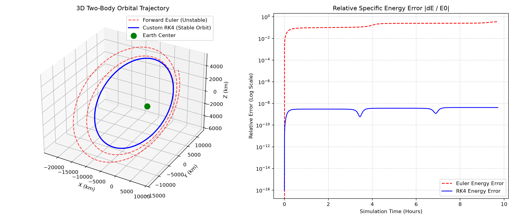

# Module 1: 3D Two-Body Orbital Mechanics & Numerical Integration

This module implements a custom numerical orbital simulator from scratch in Python, comparing the stability of **Forward Euler** against a **4th-Order Runge-Kutta (RK4)** integrator for a satellite in an inclined elliptical orbit.

## 1. Mathematical Formulation

In vector form, Newton's Law of Universal Gravitation for a satellite orbiting Earth is a second-order nonlinear vector ODE:

$$\ddot{\mathbf{r}} = -\frac{\mu}{\|\mathbf{r}\|^3}\mathbf{r}$$

Where:
- $\mathbf{r} = [x, y, z]^T$ is the 3D position vector in kilometers.
- $\mu = 398600.4418 \text{ km}^3/\text{s}^2$ is Earth's standard gravitational parameter.

### State-Space Reduction
To solve this numerically, the second-order vector equation is converted into a coupled system of six first-order scalar ODEs using the state vector $\mathbf{Y} = [x, y, z, v_x, v_y, v_z]^T$:

$$\frac{d}{dt} \begin{bmatrix} x \\ y \\ z \\ v_x \\ v_y \\ v_z \end{bmatrix} = \begin{bmatrix} v_x \\ v_y \\ v_z \\ -\frac{\mu}{r^3}x \\ -\frac{\mu}{r^3}y \\ -\frac{\mu}{r^3}z \end{bmatrix}$$

## 2. Simulation Results

The simulation integrates the trajectory over 3.5 full orbits with a time step of $\Delta t = 20\text{s}$. The specific mechanical energy $\mathcal{E}$ is tracked to measure numerical stability:

$$\mathcal{E} = \frac{\|\mathbf{v}\|^2}{2} - \frac{\mu}{\|\mathbf{r}\|}$$



* **Forward Euler (Red Dashed):** Suffers from numerical instability, causing artificial energy growth that flings the satellite out of orbit.
* **Custom RK4 (Blue Solid):** Preserves specific mechanical energy near machine precision, locking the satellite onto a stable Keplerian ellipse.

## 3. How to Run

Make sure you have `numpy` and `matplotlib` installed, then run:

```bash
python two_body_rk4.py
```
