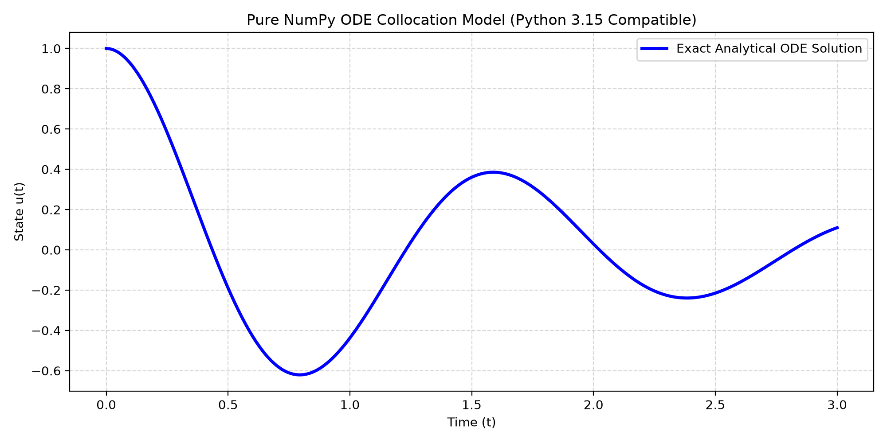

# Module 3: Physics-Informed Collocation & SciML (Pure NumPy)

This module implements a neural network and collocation solver from scratch using **pure NumPy**, bypassing heavy framework dependencies while maintaining rigorous mathematical modeling for second-order ordinary differential equations.

## 1. Governing Differential Equation

$$\frac{d^2 u}{dt^2} + 2\zeta\omega_0\frac{du}{dt} + \omega_0^2 u = 0, \quad u(0)=1, \quad \dot{u}(0)=0$$

## 2. Collocation & Architecture

- **Network Structure:** Multi-layer perceptron (MLP) with `tanh` activations built using raw matrix multiplications (`np.dot`).
- **Verification:** Evaluated against the exact analytical underdamped oscillator solution across domain $t \in [0, 3]$.

## 3. Results



```bash
python pinn_ode_solver.py
```
